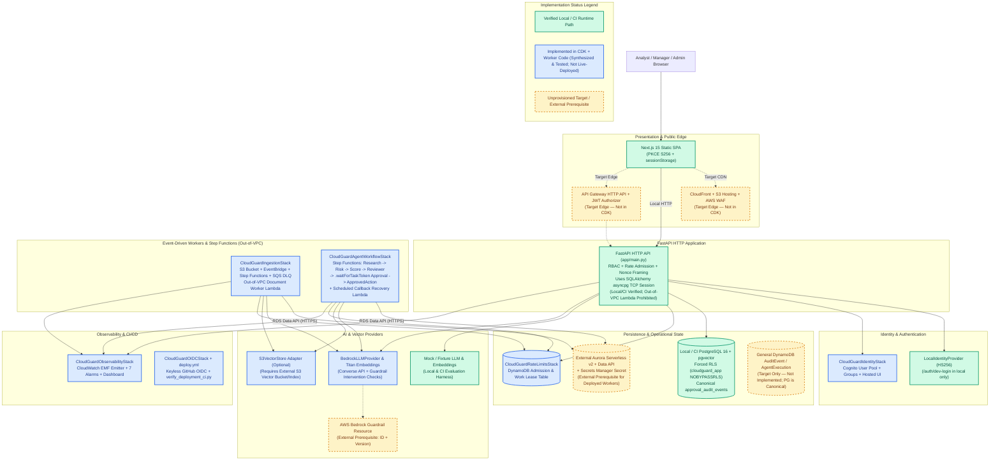

# CloudGuard AI

**Agentic audit & compliance intelligence platform on AWS**

Upload a governance corpus — policies, controls documentation, audit reports,
vendor assessments — and get evidence-linked answers, detected control gaps,
deterministically scored risk, and an auditable trail from every recommendation
back to the chunks that produced it and the human who approved it.

> **Status: Phase 12 of 12 — Polish & Handoff (Local & CI Validated Checkpoint).**
> Phases 1–11 are implemented in repository code and verified across unit, PostgreSQL
> Row-Level Security (RLS), security-regression, evaluation-fixture, and offline CDK
> synthesis test suites.
> **Truthfulness note:** Zero live AWS cloud resources have been deployed from this
> repository, live AWS deployment reproducibility remains unverified, and no paid live
> Amazon Bedrock evaluations have been executed. Reported evaluation and benchmark
> figures come from deterministic/local-pgvector synthetic fixtures (`Security Gate: PASS`,
> `Quality Gate (Advisory): WARN`, unmeasured live inference cost reported as
> `null`/`None`). See [Deployment Prerequisites, Scanner Exceptions & Stacked PRs](#deployment-prerequisites-scanner-exceptions--stacked-prs)
> before running any cloud deployment.

---

## Implemented Foundation (Phases 1–11)

| Layer | Implemented in Repository | Validation Status |
|---|---|---|
| **Backend API** | FastAPI on Python 3.12 (`api → services → repositories`), 9 v1 route modules (`/health`, `/system`, `/auth`, `/documents`, `/retrieval`, `/rag`, `/compliance`, `/approvals`, `/evaluations`) | Verified locally & in CI (`asyncpg` over TCP; see [HTTP API deployment boundary](#architectural-status--implementation-boundaries)) |
| **Ports & Adapters** | **17 domain port modules** (18 abstract interfaces) in [`backend/app/ports/`](backend/app/ports/): **13 port modules have AWS/cloud adapters** and **4 port modules are local/SQLAlchemy-only** (`approval_repository`, `compliance_repository`, `evaluation_repository`, `approved_action_executor`; see [ADR-0013](docs/adr/0013-ports-and-adapters.md)). `boto3` is banned outside `app/adapters/` by Ruff. | Enforced by lint + unit & integration tests |
| **Persistence & RLS** | SQLAlchemy `>=2.1.0` async (`asyncpg`) for local/CI; RDS Aurora Data API adapters for deployed background workers; Alembic migrations `0001`–`0013`; **forced PostgreSQL RLS** under `NOBYPASSRLS` runtime role `cloudguard_app` | Verified against real PostgreSQL 16 + `pgvector` in CI |
| **Authentication & RBAC** | JWT bearer tokens — Cognito RS256 JWKS verifier in AWS, local HS256 offline (`/auth/dev-login` unmounted outside `local`); centralized 3-role permission matrix + role-derived confidentiality clearance ceilings (`analyst` → `internal`, `manager` → `confidential`, `admin` → `restricted`) | Exhaustive `(role, permission)` and route-matrix regressions |
| **Ingestion & RAG** | Presigned S3 upload registration/completion, per-document ingestion budgets, structure-aware chunking, dense/hybrid vector search (`pgvector` and `S3VectorStore`), deterministic source labels (`[S1]`, `[S2]`), zero-evidence abstention | Unit + PostgreSQL `pgvector` integration tests |
| **Compliance & Risk** | Deterministic, versioned Python scoring (`v1.0`), actor-independent score computation, clearance-filtered evidence projection (`hidden_evidence_present`), immutable snapshots, Manager-only score overrides, bounded LLM candidate extraction | Unit + PostgreSQL integration tests |
| **Bounded Agents & Approval** | Fixed `Research → Risk → Reviewer` graph, fail-closed `ToolRegistry` intersecting agent allowlist + human `Principal`, Step Functions `.waitForTaskToken` Manager approval pause, bounded readiness polling (`CG-14`), canonical PostgreSQL `approval_audit_events` trigger ledger, idempotent `create_security_review` execution | Unit, callback-race, and PostgreSQL trigger/privilege tests |
| **AI & App Security** | Per-request cryptographic nonce prompt framing, fail-closed Bedrock Guardrail intervention handling, bounded sensitive-data detection/minimization, central API rate admission (`RateLimitStore`), shared tenant worker-step admission (`WorkAdmission`), sanitized errors & structured log redaction | **109 blocking security regression tests** (`94` service/route/contract + `6` callback race + `9` PostgreSQL RLS/catalog in `backend/tests/security/`) |
| **Evaluation & Benchmarks** | 50-case golden dataset (`evals/golden_dataset.jsonl`) + 16 adversarial prompt-injection/boundary cases (`evals/adversarial.jsonl` + harness), `EvaluationHarness`, CLI runner (`scripts/run_evals.py`), and opt-in vector store benchmark (`scripts/benchmark_vector_stores.py`) | Blocking security gate (`PASS`) + advisory quality gate (`WARN`) on synthetic fixtures |
| **Observability** | Provider-neutral `TelemetryEmitter`, `safe_telemetry_call` failure isolation, closed dimension sets, `CloudWatchEMFTelemetryEmitter` with unordered dimension-set deduplication, versioned Bedrock pricing catalog (`2026-03-01`), separated model-call vs. user-query cost accounting | 48 telemetry unit tests + CDK `ObservabilityStack` assertions |
| **Infrastructure & CI/CD** | **6 AWS CDK (Python) stacks** (`CloudGuardIdentity`, `CloudGuardRateLimits`, `CloudGuardIngestion`, `CloudGuardAgentWorkflow`, `CloudGuardObservability`, `CloudGuardOIDC`), blocking 4-job GitHub Actions CI (`ci.yml`), nightly fixture evaluation (`nightly-eval.yml`), and manual OIDC deployment workflow (`deploy.yml` + `scripts/verify_deployment_ci.py`) | **63 CDK tests passing** + offline synthesis of all 6 stacks (live cloud deploy unverified) |
| **Frontend** | Next.js 15 static export, React 19, TypeScript, Tailwind v4, Cognito Hosted UI OAuth2 Authorization Code + PKCE (`S256`) with `state`/`nonce` validation, Dashboard (`/dashboard`) and Evaluation & Analytics (`/analytics`) views | **8 Vitest tests passing**, ESLint, `tsc --noEmit`, and static build clean |

**Test & Verification Totals:**
- **1,392 backend tests passing** (including real PostgreSQL 16 + `pgvector` RLS, runtime privilege, callback synchronization race, and **109** security regression tests)
- **63 infrastructure CDK tests passing** across 6 synthesized stacks
- **8 frontend Vitest component/auth tests passing**
- **`ruff`, `mypy`, `eslint`, `tsc`, `pip-audit`, `npm audit --audit-level=high`, `gitleaks`, and `trivy` clean in CI**

---

## Reproducible Least-Privilege Local Setup & Startup

### Prerequisites
- **Python 3.12+** (CI runs Python 3.12; local validation also verified on Python 3.13/3.14)
- **Node.js 22+** and `npm`
- **Docker Desktop** (for PostgreSQL 16 + `pgvector` and LocalStack)

> **Important Note on `scripts/local_setup.sh` and `Makefile`:**
> The legacy `scripts/local_setup.sh` and `Makefile` targets (`make setup`, `make up`, `make api`) were written in Phase 1. They omit provisioning the `cloudguard_app` (`NOBYPASSRLS`) role before migrations, use an unbounded readiness loop, and start `uvicorn` using the default `.env` schema-owner credentials (`DB_USER=cloudguard`) rather than the least-privilege runtime role (`DB_USER=cloudguard_app`). **Use the complete least-privilege setup commands below** so schema-owner migration/seeding credentials stay strictly separated from `cloudguard_app` API runtime credentials.

### Complete Setup Path (Windows PowerShell)

```powershell
# 1. Clone the repository and select the implemented feature branch
#    (main does not yet contain the unmerged stacked Phase 8–12 branches)
git clone https://github.com/aaradhyapartap/cloudguard-ai.git
Set-Location cloudguard-ai
git checkout phase-11-devops   # or phase-12-polish once published

# 2. Create local environment files from templates
if (-not (Test-Path .env)) { Copy-Item .env.example .env }
if (-not (Test-Path frontend/.env.local)) { Copy-Item frontend/.env.local.example frontend/.env.local }

# 3. Install backend (includes pytest, mypy, ruff) and infrastructure dependencies in the active Python environment,
#    then install frontend dependencies
python -m pip install -e "./backend[dev]" -r ./infrastructure/requirements.txt
Set-Location frontend
npm install
Set-Location ..

# 4. Start PostgreSQL 16 (with pgvector) and LocalStack, with a bounded readiness check (max 30 attempts)
docker compose up -d
$Ready = $false
for ($i = 1; $i -le 30; $i++) {
    docker compose exec -T postgres pg_isready -U cloudguard -d cloudguard *> $null
    if ($LASTEXITCODE -eq 0) { $Ready = $true; break }
    Start-Sleep -Seconds 1
}
if (-not $Ready) { throw "PostgreSQL did not become ready within 30 seconds." }

# 5. Provision the least-privilege runtime role (cloudguard_app, NOBYPASSRLS) BEFORE running migrations
#    (migrations 0005–0013 grant exact per-table privileges to cloudguard_app)
docker compose exec -T postgres psql -U cloudguard -d cloudguard -v ON_ERROR_STOP=1 -c "
DO `$`$
BEGIN
  IF NOT EXISTS (SELECT 1 FROM pg_roles WHERE rolname = 'cloudguard_app') THEN
    CREATE ROLE cloudguard_app LOGIN PASSWORD 'cloudguard_app' NOSUPERUSER NOCREATEDB NOCREATEROLE NOBYPASSRLS;
  ELSE
    ALTER ROLE cloudguard_app WITH LOGIN PASSWORD 'cloudguard_app' NOSUPERUSER NOCREATEDB NOCREATEROLE NOBYPASSRLS;
  END IF;
END
`$`$;
GRANT CONNECT ON DATABASE cloudguard TO cloudguard_app;
GRANT USAGE ON SCHEMA public TO cloudguard_app;
"

# 6. Apply Alembic migrations 0001–0013 and seed synthetic data using SCHEMA-OWNER credentials (cloudguard)
$env:DB_USER="cloudguard"
$env:DB_PASSWORD="cloudguard"
Set-Location backend
python -m alembic upgrade head
Set-Location ..
python scripts/seed_data.py
```

Start the API under **least-privilege runtime credentials (`cloudguard_app`)** and start the frontend in two PowerShell terminals:

```powershell
# Terminal 1 — Backend API running as NOBYPASSRLS role 'cloudguard_app' (http://localhost:8000/docs)
Set-Location backend
$env:DB_USER="cloudguard_app"
$env:DB_PASSWORD="cloudguard_app"
python -m uvicorn app.main:app --reload --port 8000

# Terminal 2 — Frontend SPA (http://localhost:3000)
Set-Location frontend
npm run dev
```

<details>
<summary>Equivalent Complete Setup Path (macOS / Linux / Git Bash / WSL)</summary>

```bash
# 1. Clone and check out the implemented branch
git clone https://github.com/aaradhyapartap/cloudguard-ai.git
cd cloudguard-ai
git checkout phase-11-devops   # or phase-12-polish once published

# 2. Environment files & dependencies
[[ -f .env ]] || cp .env.example .env
[[ -f frontend/.env.local ]] || cp frontend/.env.local.example frontend/.env.local
python3 -m pip install -e "./backend[dev]" -r ./infrastructure/requirements.txt
(cd frontend && npm install)

# 3. Start containers and run bounded readiness check (max 30s)
docker compose up -d
ready=0
for i in {1..30}; do
  if docker compose exec -T postgres pg_isready -U cloudguard -d cloudguard >/dev/null 2>&1; then
    ready=1
    break
  fi
  sleep 1
done
[[ "$ready" -eq 1 ]] || { echo "PostgreSQL failed to become ready in 30s" >&2; exit 1; }

# 4. Provision least-privilege runtime role (cloudguard_app, NOBYPASSRLS) before migrations
docker compose exec -T postgres psql -U cloudguard -d cloudguard -v ON_ERROR_STOP=1 <<'SQL'
DO $$
BEGIN
  IF NOT EXISTS (SELECT 1 FROM pg_roles WHERE rolname = 'cloudguard_app') THEN
    CREATE ROLE cloudguard_app LOGIN PASSWORD 'cloudguard_app' NOSUPERUSER NOCREATEDB NOCREATEROLE NOBYPASSRLS;
  ELSE
    ALTER ROLE cloudguard_app WITH LOGIN PASSWORD 'cloudguard_app' NOSUPERUSER NOCREATEDB NOCREATEROLE NOBYPASSRLS;
  END IF;
END
$$;
GRANT CONNECT ON DATABASE cloudguard TO cloudguard_app;
GRANT USAGE ON SCHEMA public TO cloudguard_app;
SQL

# 5. Run migrations and seed data as schema owner (cloudguard)
(cd backend && DB_USER=cloudguard DB_PASSWORD=cloudguard python3 -m alembic upgrade head)
DB_USER=cloudguard DB_PASSWORD=cloudguard python3 scripts/seed_data.py

# 6. Start backend API as least-privilege runtime role (cloudguard_app) in Terminal 1:
#    cd backend && DB_USER=cloudguard_app DB_PASSWORD=cloudguard_app python3 -m uvicorn app.main:app --reload --port 8000
# 7. Start frontend in Terminal 2:
#    cd frontend && npm run dev
```
</details>

> **Build-time font note.** `next/font/google` downloads IBM Plex at build time and
> self-hosts it in the static output — there is no runtime browser request to Google.
> That means `npm run build` requires build-time access to `fonts.googleapis.com`.

---

## Reproducible Testing, Evaluation & Benchmark Commands

### 1. Backend Linting, Type-Checking, and Unit Tests (No DB Required)

```powershell
Set-Location backend
python -m ruff check .
python -m mypy app tests/security ../scripts/benchmark_vector_stores.py ../scripts/verify_deployment_ci.py
python -m pytest -m "not integration" -ra
Set-Location ..
```

### 2. Full Backend Suite with Real PostgreSQL RLS & Blocking Security Regressions

Runs all **1,392 backend tests** — including tenant isolation, forced RLS, least-privilege table grants, and the **109-test** security regression suite (`94` service/route/contract + `6` callback race + `9` PostgreSQL RLS/catalog) — connected as the `NOBYPASSRLS` runtime role `cloudguard_app`:

```powershell
Set-Location backend
$env:DB_USER="cloudguard_app"
$env:DB_PASSWORD="cloudguard_app"
$env:RUN_DB_TESTS="1"
$env:REQUIRE_SECURITY_DB_TESTS="1"
python -m pytest -ra
Set-Location ..
```

### 3. Infrastructure CDK Tests & Offline CloudFormation Synthesis

Requires `infrastructure/requirements.txt` plus `pytest`, `mypy`, and `ruff` (installed above via `python -m pip install -e "./backend[dev]" -r ./infrastructure/requirements.txt`):

```powershell
Set-Location infrastructure
python -m ruff check .
python -m mypy stacks tests
python -m pytest -ra
npx cdk synth -c offline_synth=true --app "python app.py"
Set-Location ..
```

### 4. Frontend Lint, Typecheck, Vitest & Static Export Build

```powershell
Set-Location frontend
npm run lint
npm run typecheck
npm test
npm run build
Set-Location ..
```

### 5. Reproducible AI & Security Evaluation CLI (`scripts/run_evals.py`)

```powershell
# In-memory deterministic fixture evaluation (no database or cloud account needed)
python scripts/run_evals.py --mode deterministic_fixture

# Real PostgreSQL + pgvector fixture evaluation with run persistence
# (Note: local_pgvector_fixture seeds synthetic corpus rows via schema-owner cleanup/setup,
#  then executes evaluation queries under tenant RLS sessions)
$env:DB_USER="cloudguard_app"
$env:DB_PASSWORD="cloudguard_app"
python scripts/run_evals.py --mode local_pgvector_fixture --persist
```

> **Evaluation Provenance & Truthfulness Disclosure:**
> - **Fixture vs. Live Model Quality:** Both `deterministic_fixture` and `local_pgvector_fixture` modes use deterministic feature-hash embeddings (`eval:feature-hash-1024-v1`) and deterministic fixture LLM/judge providers (`eval:fixture-llm-v1`, `eval:fixture-judge-v1`) over the 50-case golden dataset (`evals/golden_dataset.jsonl`) and 16 adversarial security cases (`evals/adversarial.jsonl` + harness checks). They validate pipeline orchestration, `pgvector` hybrid retrieval, RLS tenant/clearance enforcement, citation filtering, and prompt-injection defenses at zero cloud cost — they **do not** measure live Amazon Bedrock foundation model quality.
> - **Gate Outcomes Preserved:**
>   - **Security Gate (Blocking):** `PASS` (`security_gate_passed: true` — `0` cross-tenant leaks, `0` unauthorized disclosures, `0` prompt-injection breaches, `1.0000` adversarial corpus pass rate across 16 cases).
>   - **Quality Gate (Advisory):** `WARN` (`quality_gate_advisory_passed: false` — `precision@5: 0.7064`, `recall@10: 0.9706`, `groundedness_score: 0.9633` / `1.0000`, `answer_relevance_score: 0.9633`, `citation_accuracy: 0.8333` vs. `0.85` advisory target, `unanswerable_abstention_rate: 0.5000` across all 16 ambiguous/unanswerable cases vs. `0.80` advisory target).
>   - **Unmeasured Cost Disclosure:** `cost_per_1000_queries_usd` is explicitly `None` (`null`) in fixture modes rather than fabricating `$0.00` live inference cost.

### 6. Vector Store Benchmark CLI (`scripts/benchmark_vector_stores.py`)

```powershell
# Zero-cost offline synthetic cosine benchmark (pgvector vs. S3 Vectors simulation)
python scripts/benchmark_vector_stores.py --mode synthetic_fixture --num-queries 5

# Local PostgreSQL pgvector benchmark (uses per-run unique UUIDs, collision checks, and owned-row cleanup)
$env:RUN_DB_TESTS="1"
$env:DB_USER="cloudguard_app"
$env:DB_PASSWORD="cloudguard_app"
python scripts/benchmark_vector_stores.py --mode local_pgvector --stores pgvector --num-queries 5
```

---

## Synthetic Demo Walkthrough

For a complete, copy-pasteable walkthrough exercising multi-tenant isolation (`Acme Manufacturing` vs. `Globex Industrial`), RBAC role segregation (`analyst`, `manager`, `admin`), document upload registration and missing-object validation, local `pgvector` corpus seeding, deterministic compliance scoring, Manager score overrides, and evaluation runs using **synthetic data only**, see **[`docs/DEMO_WALKTHROUGH.md`](docs/DEMO_WALKTHROUGH.md)**.

---

## Architectural Status & Implementation Boundaries

- **Target design:** [`docs/architecture/00-phase0-architecture.md`](docs/architecture/00-phase0-architecture.md)
- **Architecture Decision Records:** [`docs/adr/`](docs/adr/README.md)
- **Threat Model & Security Policy:** [`docs/THREAT_MODEL.md`](docs/THREAT_MODEL.md) and [`SECURITY.md`](SECURITY.md)
- **Interview Notes & Evidence-Backed Resume Bullets:** [`docs/INTERVIEW_NOTES.md`](docs/INTERVIEW_NOTES.md)

The diagram below distinguishes **(1) implemented local/CI paths**, **(2) implemented CDK & deployed-worker designs**, and **(3) target or external infrastructure not provisioned by this repository**:



### Three Load-Bearing Architectural Properties

1. **Tenant isolation is enforced twice.** Application repositories parameterize every query with `organization_id`, *and* PostgreSQL `FORCE ROW LEVEL SECURITY` policies on every tenant table refuse to return or mutate another tenant's rows under the `cloudguard_app` (`NOBYPASSRLS`) role.
2. **Models and untrusted documents never hold authority.** Every prompt wraps user input and retrieved evidence in per-request cryptographic nonce delimiters; tool invocations are validated against static per-agent allowlists *and* the caller's `Principal`; citations are mapped deterministically from admitted retrieval chunks; compliance risk scores are computed in deterministic Python (`scoring_version="v1.0"`); and consequential actions halt at Step Functions `.waitForTaskToken` until an authenticated Manager decides.
3. **Out-of-VPC Worker vs. Direct-TCP HTTP API Boundary (ADR-0008).** All 7 deployed background worker entrypoints (`deployed_document_worker.py`, `deployed_research_agent_worker.py`, `deployed_risk_agent_worker.py`, `deployed_reviewer_agent_worker.py`, `deployed_approval_creation_worker.py`, `deployed_approval_callback_recovery_worker.py`, and `deployed_approved_action_execution_worker.py`) run as out-of-VPC Lambda functions communicating with Aurora Serverless v2 over the HTTPS **RDS Data API**, avoiding a ~$32/month NAT Gateway. By contrast, the FastAPI HTTP layer (`app/api/v1/`) and its repositories (`ApprovalRepository`, `ComplianceRepository`, `EvaluationRepository`, `DocumentRepository`) use SQLAlchemy `AsyncSession` (`asyncpg`) over direct TCP port 5432; **deploying the unadapted `asyncpg` HTTP container into an out-of-VPC Lambda is prohibited** and requires either an HTTP Data API persistence adapter or an in-VPC compute target.

---

## Project Layout

```text
backend/
  app/
    api/v1/         FastAPI routers (/health, /system, /auth, /documents, /retrieval, /rag, /compliance, /approvals, /evaluations)
    core/           Typed Settings, structured logging/redaction, error projections, DI containers
    models/         Pydantic domain schemas, Principal, telemetry & evaluation models
    ports/          17 domain port modules (18 abstract interfaces; zero SQLAlchemy or boto3 types)
    adapters/       Concrete adapters: local/ (SQLAlchemy/memory), mock/, aws/ (Data API, S3, S3 Vectors, DynamoDB, EMF, SFN), bedrock/, cognito/
    repositories/   SQLAlchemy table definitions and Principal-scoped repositories
    security/       RBAC matrix (authz.py), rate limits, ingestion/resource budgets, prompt framing, PII detection
    services/       Domain services (documents, retrieval, rag, compliance, agents, agent_workflow, approval, work_admission, evaluation)
    evaluations/    Reproducible golden/adversarial dataset loader, fixture providers, metrics math, EvaluationHarness
    telemetry/      Boundary failure isolation (safe_telemetry_call) and versioned Bedrock pricing catalog
    deployed_*_worker.py  7 out-of-VPC AWS Lambda entrypoint handlers for ingestion, agents, and approvals
  migrations/       Alembic migrations 0001–0013 (immutable published history)
  tests/            unit/, integration/ (real PostgreSQL RLS), security/ (109 blocking regressions)
infrastructure/
  app.py            CDK entrypoint synthesizing 6 stacks
  stacks/           identity, rate_limit, ingestion, agent_workflow, observability, oidc
  tests/            63 pytest CDK template & workflow regressions
frontend/
  src/              Next.js 15 App Router (/login, /dashboard, /analytics), PKCE auth client, Vitest tests
evals/              Versioned golden_dataset.jsonl (50 cases) and adversarial.jsonl (8 corpus cases)
scripts/            local_setup.sh, seed_data.py, run_evals.py, benchmark_vector_stores.py, verify_deployment_ci.py
docs/
  architecture/     Phase 0 baseline architecture & updated implementation diagrams
  adr/              Architecture Decision Records (ADR-0001 through ADR-0018)
  security/         Authorization matrix, prompt injection, data handling, rate limiting, budgets, worker admission
  development/      current-task.md and phase handoff checkpoints (phase8 through phase12)
  DEMO_WALKTHROUGH.md  Reproducible synthetic-data demo guide
  INTERVIEW_NOTES.md   Evidence-backed resume bullets & architectural Q&A
```

---

## Roadmap

| Phase | Scope | Status |
|---|---|---|
| 0 | Architecture & ADRs | ✅ Complete |
| 1 | Foundation, ports & adapters, Docker local stack | ✅ Complete |
| 2 | Cognito & local JWT authentication, RBAC & RLS end to end | ✅ Complete |
| 3 | Event-driven document ingestion pipeline & Data API worker | ✅ Complete |
| 4 | Hybrid RAG: chunking, embeddings, `pgvector` retrieval, deterministic citations | ✅ Complete |
| 5 | Deterministic Python compliance & risk scoring engine (`v1.0`) | ✅ Complete |
| 6 | Bounded multi-agent workflow (`Research → Risk → Reviewer`) & `ToolRegistry` | ✅ Complete |
| 7 | Human Manager approval (`.waitForTaskToken`), callback recovery & immutable audit | ✅ Complete |
| 8 | Security hardening: threat model, nonce framing, PII controls, rate/worker admission, CI gates | ✅ Complete (PR #1) |
| 9 | Reproducible AI & security evaluation harness, golden/adversarial datasets, `/analytics` UI | ✅ Complete (PR #2) |
| 10 | Privacy-safe EMF observability, cost-per-query accounting, CloudWatch dashboard & alarms | ✅ Complete (PR #3) |
| 11 | Keyless GitHub OIDC stack, protected manual deploy workflow, `S3VectorStore` & benchmark CLI | ✅ Accepted repository/CI checkpoint (PR #4; offline CDK synth & CI verified; live deployment reproducibility unverified) |
| 12 | Documentation reconciliation, architecture diagrams, demo walkthrough, interview notes & handoff | ✅ Complete (`phase-12-polish`) |

---

## Deployment Prerequisites, Scanner Exceptions & Stacked PRs

### 1. External Cloud Prerequisites Before Running `.github/workflows/deploy.yml`
No live AWS resources have been provisioned, and live deployment reproducibility remains unverified. Before triggering a manual deployment:
1. **CDK Bootstrap:** Bootstrap the target AWS account/region with standard qualifier `hnb659fds` (`cdk bootstrap aws://<ACCOUNT_ID>/<REGION>`).
2. **Aurora Serverless v2 PostgreSQL + Data API:** Provision an Aurora PostgreSQL 16 cluster with `pgvector` and **RDS Data API enabled**, store credentials in Secrets Manager, create the `cloudguard_app` (`NOBYPASSRLS`) role, and apply Alembic migrations `0001`–`0013`.
3. **Amazon Bedrock Access & Guardrail:** Enable model access in the target region (`anthropic.claude-haiku-4-5-20251001-v1:0`, `amazon.nova-pro-v1:0`, `amazon.titan-embed-text-v2:0`) and provision a Bedrock Guardrail (`BEDROCK_GUARDRAIL_ID` and `BEDROCK_GUARDRAIL_VERSION` are mandatory for `prod`).
4. **GitHub Environment Protection & Variables:** Configure GitHub Environments (`dev`, `staging`, `prod`) with required reviewers and environment variables (`AWS_DEPLOY_ROLE_ARN`, `AWS_REGION`, `AWS_AURORA_CLUSTER_ARN`, `AWS_AURORA_SECRET_ARN`, plus `BEDROCK_GUARDRAIL_ID` and `BEDROCK_GUARDRAIL_VERSION` for `prod`).
5. **Optional S3 Vectors:** If using `VECTOR_STORE=s3_vectors`, create an S3 Vector bucket and 1024-dim cosine index where `organization_id`, `confidentiality_level`, and `document_id` remain filterable metadata keys.

### 2. Active Scanner Exceptions & Expiry Schedule
- **Container Image Vulnerability Exception ([`.trivyignore.yaml`](.trivyignore.yaml)):**
  - **CVE:** `CVE-2026-111943` scoped strictly to `usr/local/bin/aws-lambda-rie` (the Go-based AWS Lambda Runtime Interface Emulator bundled in upstream `public.ecr.aws/lambda/python:3.12`, used only for local emulation and never invoked by AWS Lambda in cloud execution).
  - **Expiry Date:** **`2026-12-01`**. Before `2026-12-01`, update the base image when AWS publishes a patched `public.ecr.aws/lambda/python:3.12` digest or strip `usr/local/bin/aws-lambda-rie` in a multi-stage `Dockerfile` build.
- **Secret Scanner Synthetic Test Allowlist ([`.gitleaksignore`](.gitleaksignore)):**
  - Contains 4 commit-and-line-scoped fingerprints for synthetic test fixtures (`test_vector_store.py:166`, `test_sensitive_data.py:23`, and `test_telemetry.py:685,1241`). The blocking CI Gitleaks scan (configured with those 4 scoped synthetic-fixture exceptions) completed with zero unallowlisted findings across the scanned repository history.

### 3. Stacked Pull Request Chain & Separately Authorized Merge Order
Phases 8–11 are published as a stacked draft PR chain on `origin` (`aaradhyapartap/cloudguard-ai`):
1. **PR #1 (`phase-8-security` → `main`):** Security Hardening (`00f38ece21e9418eace66a7fb63b449a9f35dd2d`)
2. **PR #2 (`phase-9-evaluation` → `phase-8-security`):** AI & Security Evaluation (`deb19cfe9edbcbf7100313000ca4d20425444e6c`)
3. **PR #3 (`phase-10-observability` → `phase-9-evaluation`):** Observability & Cost Accounting (`4d7aa9c5b0f68d1858d757484e4df2f7057120e1`)
4. **PR #4 (`phase-11-devops` → `phase-10-observability`):** Keyless OIDC Deployment & S3 Vectors (`a318c0c45c70db857dc727061c66ad701b164d5e`)
5. **Local Branch (`phase-12-polish` from `phase-11-devops`):** Documentation, Diagrams, Demo Walkthrough & Handoff

When separately authorized to merge, merge sequentially from bottom to top (`PR #1` → retarget & merge `PR #2` → retarget & merge `PR #3` → retarget & merge `PR #4` → publish & merge `phase-12-polish` into `main`). Note that GitHub Actions `workflow_dispatch` triggers for `.github/workflows/deploy.yml` and `.github/workflows/nightly-eval.yml` become active in the GitHub UI only after those workflow files land on `main`.

---

## Security

See [`SECURITY.md`](SECURITY.md), [`docs/THREAT_MODEL.md`](docs/THREAT_MODEL.md), and [`docs/security/AUTHORIZATION_MATRIX.md`](docs/security/AUTHORIZATION_MATRIX.md).

## Licence

MIT — see [`LICENSE`](LICENSE).
